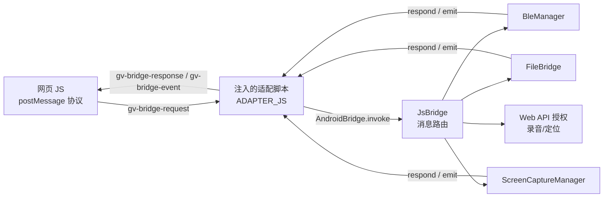

# 网页转安卓 App 适配教程（WebView 壳 + 原生桥）

> 发版、签名钥匙、回滚等发布相关的事，见 `docs/RELEASE_GUIDE.md`；版本配对以网页仓库
> `RELEASE.md` 为准。

> 本文档说明如何把任意网页（如 `https://your-site.example/`）打包成安卓应用，
> 并让网页里的 JavaScript 通过「原生桥」调用安卓能力：蓝牙、持续文件写入、录屏、
> 麦克风录音、定位。
>
> 适用工程：`geckoview_example_app/`（GitHub: `git@github.com:totooicu/geckoview_example.git`）
> 当前版本：v1.1.1（WebView 方案）

---

## 1. 项目简介

| 项 | 说明 |
|---|---|
| 渲染内核 | 系统 WebView（Chromium） |
| 桥方案 | `addJavascriptInterface` 注入 `window.AndroidBridge`，页面零改动使用旧 `postMessage` 协议 |
| 原生能力 | 蓝牙（Central + Peripheral）、文件读写（私有/公共）、录屏（MP4 + 抽帧）、WebRTC 录音、地理定位 |
| 壳特性 | 全屏无地址栏、域名锁定（防外链）、UA 标识、浏览器环境识别（`getEnv()`） |
| 包体 | Debug APK ≈ 3.5MB（minSdk 26 / targetSdk 36） |

架构关系：



---

## 2. 快速上手（跑通你自己的 App）

### 2.1 前置环境

- **JDK 17**（本项目用 17；`export JAVA_HOME=/path/to/jdk-17`）
- **Android SDK**（含 build-tools 35.0.0+；`local.properties` 里写 `sdk.dir=/path/to/android-sdk`）
- Gradle 使用项目自带 wrapper（9.3.1），无需单独安装

### 2.2 只需改 4 处即可换皮

| 要改的东西 | 位置 | 说明 |
|---|---|---|
| **目标网页地址** | `WebViewActivity.java` → `DEFAULT_URL` | 改成你的页面；当前策略是站点根路径（见 §3.1 末尾） |
| **允许的域名** | `WebViewActivity.java` → `ALLOWED_HOST` | 域名锁；页面内所有跳转只允许此域 |
| **应用名** | `app/src/main/res/values/strings.xml` → `app_name` | 桌面显示名 |
| **图标** | `app/src/main/res/drawable/logo.png` | 应用图标 |

可选项：

| 项 | 位置 | 说明 |
|---|---|---|
| 版本号 | `app/build.gradle` → `versionName` | 展示用 |
| 应用 ID | `app/build.gradle` → `applicationId` | 包名，发布后不可改 |
| 顶部填充条 | `WebViewActivity.java` → `dp(42)` | 无地址栏后避免内容被状态栏遮挡 |
| UA 标识 | `WebViewActivity.java` → `setUserAgentString` | 网页可用 `navigator.userAgent` 识别 |

### 2.3 编译

```bash
cd geckoview_example_app
./gradlew :app:assembleDebug --no-daemon
# 产物：app/build/outputs/apk/debug/app-debug.apk
```

安装：`adb install app-debug.apk`，或直接把 APK 传到手机安装。

---

## 3. 网页端如何调用原生能力

网页**不需要任何改动**就能用桥——前提是网页代码按下面的协议发消息。

### 3.1 先判断自己是不是跑在这个 App 里

```js
function getEnv() {
  if (window.AndroidBridge && typeof window.AndroidBridge.getEnv === 'function') {
    return JSON.parse(window.AndroidBridge.getEnv());
  }
  return null; // 普通浏览器（Chrome/微信/...）
}

// 返回示例：{"app":"DatingRecord","version":"1.0.0","builtAt":"2026-10-25 17:48","commit":"a1b2c3d","platform":"android","isApp":true,"bridge":"jsi-v1","proto":1}
```

`version` 是壳版本，`builtAt` 是这次构建的打包时间（Asia/Shanghai，`gradle`
打包时刻注入 `BuildConfig.BUILD_TIME`），`commit` 是打包时的最后一次 git 提交
（短哈希，注入 `BuildConfig.GIT_COMMIT`）——同号重打包时版本号分不出先后，
网页的版本条靠这两个数显示「壳 1.1.1（10-25 17:48 @ a1b2c3d）」、说清「跑的是
哪份代码」；`proto` 是桥协议版本：网页用这些数判断能不能配对（网页侧
`core/compat/pairing.ts` + 适配测试的「版本配对」卡片，发版纪律见网页仓库 `RELEASE.md`）。
**桥只增不删**——加 `action` 不用升 `proto`，删 `action` 或改参数语义必须升，并且与网页同版本发布。

用途：在本 App 内 → 调用原生桥（蓝牙/文件/录屏）；在普通浏览器 → 用 Web 标准 API（Web Bluetooth、File System Access 等）或提示下载 App。

**`DEFAULT_URL` 当前指向站点根路径**（v1.1.0 起）：<br>
`https://totooicu.github.io/DatingRecord/`。根路径跟着网页 `main` 走，网页修 bug 不必再发壳；
代价是壳里的页面会随网页发版变化，排查问题时先看「版本配对」卡里的网页版本。

如需锁死版本，可指向网页仓库的冻结快照 `https://<站点>/<仓库>/releases/v<大版本>/`：它由
release 流水线在打 `v1.x` tag 时写入，日常部署会保留。两种策略二选一，别混着用
（见 `docs/RELEASE_GUIDE.md` 第二节、网页仓库 `RELEASE.md`）。

### 3.2 请求-响应协议（核心）

- **页面 → 原生**：`window.postMessage({type:'gv-bridge-request', id, action, params}, '*')`
- **原生 → 页面（应答）**：`{type:'gv-bridge-response', id, ok, result?, error?}`（按 `id` 匹配）
- **原生 → 页面（事件）**：`{type:'gv-bridge-event', event, data?}`（如 `ble.deviceFound`）

页面端封装示例（可直接复制）：

```js
/* 发起一次桥调用，返回 Promise */
function bridge(action, params, timeoutMs = 10000) {
  return new Promise((resolve, reject) => {
    const id = 'r' + Date.now() + Math.random().toString(16).slice(2);
    const timer = setTimeout(() => {
      window.removeEventListener('message', onMsg);
      reject(new Error('bridge timeout: ' + action));
    }, timeoutMs);

    function onMsg(e) {
      const m = e.data;
      if (!m || m.type !== 'gv-bridge-response' || m.id !== id) return;
      clearTimeout(timer);
      window.removeEventListener('message', onMsg);
      m.ok ? resolve(m.result) : reject(new Error(m.error || 'bridge error'));
    }
    window.addEventListener('message', onMsg);
    window.postMessage({ type: 'gv-bridge-request', id, action, params: params || {} }, '*');
  });
}

/* 监听原生事件 */
window.addEventListener('message', (e) => {
  const m = e.data;
  if (m && m.type === 'gv-bridge-event') {
    console.log('[event]', m.event, m.data);
  }
});
```

> 桥由 App 在 `onPageStarted` / `onPageFinished` 注入适配脚本自动接通，页面无需等待标记，首次调用前 `await bridge('ping')` 即可自检。

> **`location.setConfig` 的权限时序**：`enabled:true` 但缺定位权限时，壳会先弹系统权限申请（与 `location.start` 同一条路径），用户的授权结果决定应答——因此这一次桥调用的 resolve/reject 可能**延迟到权限弹窗有了结果之后**；用户拒绝时回 `ok:false`（不静默跳过），页面应据此降级（如退回页面自己的定时器）。

> **`location.getFix`（手动一次性定位）**：手动「我的位置 / 打点」优先走这条，与连续打点同一个原生 GPS 源（`LocationManager.requestSingleUpdate`），绕开 WebView 拦截的 `navigator.geolocation`（那套在壳里常「申请了定位却回不来坐标」）。成功回 `{lat,lng,accuracy}`（WGS-84 米，页面换算 GCJ-02）；失败回 `ok:false`（权限被拒 / 信号不可用 / 超时）；缺定位权限时同样先弹系统权限申请，拒绝回 `ok:false`；**务必及时应答**，否则页面会卡到自身 9s 超时。详见 `docs/DEVELOPMENT_GUIDE.md` §2。

### 3.3 常用调用示例

```js
// 蓝牙扫描（10 秒）
await bridge('ble.startScan', { timeout: 10000 });
// 停止扫描
await bridge('ble.stopScan');

// 写私有文件（App 数据目录）
await bridge('file.writePrivate', { name: 'data.json', content: '{"a":1}' });
// 追加写公共目录文件
await bridge('file.appendPublic', { name: 'record.txt', content: 'more\n' });

// 开始录屏（会触发系统授权）
await bridge('screen.start', { name: 'capture.mp4' });
// 停止录屏
await bridge('screen.stop');
// 取状态
await bridge('screen.status');
```

### 3.4 返回键转发（ui.*）

壳默认**不直接处理返回键**，而是把按键转给网页决定：

| action / 事件 | 方向 | 说明 |
|---|---|---|
| `ui.backPressed`（事件） | 原生→页面 | 用户按返回；data `{atRoot: bool}`（壳的 WebView 导航栈是否在根部，SPA 内部路由仅供参考） |
| `ui.finish` | 页面→原生 | 网页决定退出 → 壳 `finish()` |
| `ui.goBack` | 页面→原生 | 网页让壳接管后退 → 壳 `goBack()` |

页面监听示例：

```js
window.addEventListener('message', (e) => {
  const m = e.data;
  if (m?.type === 'gv-bridge-event' && m.event === 'ui.backPressed') {
    if (router.canGoBack()) { router.back(); return; }   // 页面自己后退
    if (confirm('确定退出吗？')) bridge('ui.finish');      // 确认退出
    // 什么都不做 → 壳 3 秒后按 canGoBack ? goBack : finish 兜底
  }
});
```

行为规则：页面加载中（桥未就绪）直接走默认；页面 3 秒内未响应则壳兜底；等待期间再按一次返回直接执行默认行为，返回键永不失效。

---

## 4. 原生能力清单

### 4.1 蓝牙 `BleManager`（含运行时权限处理）

| action | 参数 | 说明 |
|---|---|---|
| `ble.status` | — | 蓝牙是否可用/已授权 |
| `ble.startScan` | `{timeout}` | 开始扫描，逐台回调 `ble.deviceFound` 事件 |
| `ble.stopScan` | — | 停止扫描 |
| `ble.connect` | `{address}` | 连接设备 |
| `ble.disconnect` | `{address}` | 断开 |
| `ble.read` | `{address, service, characteristic}` | 读特征值（返回 base64） |
| `ble.write` | `{address, service, characteristic, value(base64), writeType}` | 写特征值 |
| `ble.subscribe` / `ble.unsubscribe` | `{address, service, characteristic}` | 订阅通知，`ble.characteristicChanged` 事件 |
| `ble.peripheral.start` | `{serviceUuid, charUuid, value(base64)}` | 启动 Peripheral（广播） |
| `ble.peripheral.stop` | — | 停止广播 |
| `ble.peripheral.setValue` | `{value(base64)}` | 更新广播/服务值 |

事件：`ble.deviceFound`、`ble.connected`、`ble.disconnected`、`ble.services`、
`ble.characteristicChanged`、`ble.peripheral.connected/disconnected`、`ble.scanFailed` 等。

权限：Android 12+（API 31+）扫描/连接/广播是**运行时权限**，App 首次调用会自动弹窗申请，
拒绝后再次调用会重新申请。

### 4.2 文件读写 `FileBridge`

| action | 说明 |
|---|---|
| `file.writePrivate` / `file.appendPrivate` | 写 App 私有目录（`filesDir`，卸载即清，无需权限） |
| `file.readPrivate` | 读私有文件（返回 base64 或文本） |
| `file.deletePrivate` / `file.listPrivate` | 删除 / 列出私有文件 |
| `file.writePublic` / `file.appendPublic` | 写公共目录（MediaStore，targetSdk 30+ 用系统文件） |
| `file.readPublic` / `file.deletePublic` | 读 / 删公共文件 |

### 4.3 录屏 `ScreenCaptureManager` + `ScreenCaptureService`

| action | 说明 |
|---|---|
| `screen.start` | 发起系统录屏授权 → 前台服务录制 → 保存到公共「影片」目录（MediaStore） |
| `screen.stop` | 停止并封存 MP4，回传文件大小/路径 |
| `screen.status` | 当前是否录制中、路径 |
| `screen.thumbnail` | 对录好的视频抽帧，返回首帧图片（base64 data URL） |

录屏涉及系统权限流程，见第 5 节「权限处理」。

### 4.4 Web 标准能力（走网页自身 API）

- **麦克风录音**：网页 `navigator.mediaDevices.getUserMedia({audio:true})` → App 弹系统麦克风授权
- **摄像头**：`getUserMedia({video:true})` → 弹摄像头授权
- **定位**：网页 `navigator.geolocation.getCurrentPosition()` → 弹定位授权
- **文件选择**：网页 `<input type="file">` → App 调起系统文件选择器（含多选、MIME 过滤）

---

## 5. 权限处理（重点）

### 5.1 Manifest 权限总表（21 个）

| 权限 | 用途 | 备注 |
|---|---|---|
| `INTERNET` | 加载网页 | 必须 |
| `BLUETOOTH` / `BLUETOOTH_ADMIN` | 老版本蓝牙 | `maxSdkVersion=30` |
| `BLUETOOTH_SCAN` | 蓝牙扫描 | API 31+ 运行时 |
| `BLUETOOTH_CONNECT` | 蓝牙连接 | API 31+ 运行时 |
| `BLUETOOTH_ADVERTISE` | 蓝牙广播 | API 31+ 运行时 |
| `ACCESS_COARSE/FINE_LOCATION` | 蓝牙扫描+定位 | 运行时 |
| `RECORD_AUDIO` | 麦克风 | 运行时 |
| `MODIFY_AUDIO_SETTINGS` | WebView 录音的音频模式 | 普通权限；部分定制 ROM 缺它会报 `NotReadableError` |
| `CAMERA` | 摄像头 | 运行时 |
| `READ_EXTERNAL_STORAGE` | 兼容旧版读文件 | `maxSdkVersion=32` |
| `WRITE_EXTERNAL_STORAGE` | 兼容旧版写文件 | `maxSdkVersion=28` |
| `ACCESS_WIFI_STATE` | 辅助扫描 | 普通权限 |
| `POST_NOTIFICATIONS` | 录屏前台通知 | API 33+ 运行时 |
| `FOREGROUND_SERVICE` | 录屏服务 | 普通权限 |
| `FOREGROUND_SERVICE_MEDIA_PROJECTION` | 录屏前台服务类型 | 必须 |
| `FOREGROUND_SERVICE_SPECIAL_USE` | 录屏兜底 | 必须 |
| `CREDENTIAL_MANAGER_*` | 凭据/自动填充兼容 | 普通权限 |

> 适配时如不需要某个能力，可删除对应权限和 Manifest 里的 service 配置。

### 5.2 三类权限的授权时机

1. **桥内权限**（蓝牙、文件、location）：由模块内部在首次调用时申请，页面无需处理，只需处理拒绝回调。
2. **Web API 权限**（录音/摄像头/定位）：页面调用 `getUserMedia` / `geolocation` 时，
   `WebChromeClient.onPermissionRequest` / `onGeolocationPermissionsShowPrompt` 自动转成系统弹窗。
   放行是异步的（先系统弹窗，回调里再 `grant()`）：期间页面切走或重复申请会让请求失效，
   `grant()` 抛 `IllegalStateException`，现在的实现提示「放行失败」而不是让壳崩掉。
   **放行前壳会先做一次麦克风自检**（`MicDiagnostics`，原生录 0.2 秒后立刻释放），
   弹窗给出 `RECORD_AUDIO` 权限 / AppOps 状态 / 系统静音开关 / WebView 内核版本 /
   两路音源的探测结果。**只有真出问题才弹窗**（两路都没拿到数据，或 AppOps 被关），
   正常录音不会被诊断打断。页面报 `NotReadableError` 时先看这份报告：原生也录不到 =
   系统没把麦克风给这个 App（弹窗里有「去设置」）；原生能录 = 内核音频路径的问题。
3. **录屏授权**（特殊）：`screen.start` 时调起系统「媒体投影」授权对话框（Android 14+ 会有两次确认）。

### 5.3 Android 14+ 录屏的三个必踩坑（均已修好，适配时勿回退）

```text
坑 1：必须先 startForeground(带 FOREGROUND_SERVICE_TYPE_MEDIA_PROJECTION) 再 getMediaProjection()
     顺序反了或两参 startForeground → SecurityException → 进程被杀（"三方应用异常"）
坑 2：createVirtualDisplay 前必须注册 MediaProjection.Callback
     否则抛 "Must register a callback before starting capture..."
坑 3：停止流程不要在 finishEncoding() 里重复检查 mStopping
     stopCapture() 已置位，重复检查会让停止逻辑被跳过 → 一直"等待保存"
```

另外保存路径要用 **MediaStore**（公共 Movies），不要用 `getExternalStoragePublicDirectory`
（targetSdk 30+ 已失效）。

---

## 6. 桥协议实现位置（改代码时看这里）

| 文件 | 职责 |
|---|---|
| `WebViewActivity.java` | 主壳：加载页面、注入适配脚本、域名锁、Web 权限、文件选择 |
| `jsbridge/JsBridge.java` | 桥入口：`invoke(id,action,params)` 路由 + `respond/emit` 回推 + `getEnv()` |
| `jsbridge/BleManager.java` | 蓝牙 Central/Peripheral |
| `jsbridge/FileBridge.java` | 文件读写 |
| `jsbridge/ScreenCaptureManager.java` + `ScreenCaptureService.java` | 录屏 |
| `app/src/main/AndroidManifest.xml` | 权限 + Activity/Service 声明 |

新增一个原生能力的最小改动（以 `foo.bar` 为例）：

1. 在 `JsBridge.dispatch()` 加路由：`else if (action.startsWith("foo.")) { mFoo.handle(id, action, params, this); }`
2. 新建 `FooBridge.java`，`handle()` 里按 action 分发，用 `this.respond(id, true, result, null)` 回答案
3. 页面端按 3.2 的 `bridge('foo.bar', {...})` 调用

---

## 7. 常见问题排查（FAQ）

| 现象 | 原因 / 处理 |
|---|---|
| 页面打不开 | 检查 `DEFAULT_URL` 是否可访问、`ALLOWED_HOST` 是否与域名一致（不含 `https://` 前缀） |
| 页面内点击外部链接没反应 | 正常——域名锁拦截了所有外链，`shouldOverrideUrlLoading` 返回 `true` |
| `AndroidBridge` 未注入 | 等 `onPageFinished` 后再调；可先 `await bridge('ping')` 自检 |
| 网页在普通浏览器也能跑 | 桥只在本 App 注入；用 `getEnv()` 判断后降级到 Web API 即可 |
| 文件选择点了没反应 | 已实现 `onShowFileChooser`；如仍失败检查页面 input 的 accept 类型 |
| 录屏点开始没弹授权 | 检查 Manifest 有 `FOREGROUND_SERVICE_MEDIA_PROJECTION`，且 `targetSdk>=34` 时规则见 5.3 |
| 蓝牙扫描不到设备 | 确认定位已授权（Android 13 以下扫描需定位）、`startScan` 的 timeout 合理 |
| 录音/定位授权弹窗不出现 | 确认 Manifest 有 `RECORD_AUDIO` / `ACCESS_FINE_LOCATION`，且页面从 https 加载 |
| 录音报 `NotReadableError`（Could not start audio source） | 权限之外先查三处：① Manifest 有没有 `MODIFY_AUDIO_SETTINGS`（普通权限，不弹框）；② 壳弹出的「麦克风自检」报告——AppOps 被关就按弹窗「去设置」打开，原生录音也失败说明系统没把麦克风交给 App，与 WebView 无关；③ 原生能录而网页不能录时看 WebView 内核版本（自检里有），Chrome 能录、壳里不能录优先把「Android System WebView」更新到和 Chrome 同代，厂商替换过的内核常常坏在这一步 |

---

## 8. 发布（Release）备注

- 目前 `minifyEnabled false`（未混淆），发布时建议开启混淆并保留 `@JavascriptInterface` 规则：

```proguard
-keepclassmembers class org.mozilla.geckoview_example.jsbridge.** {
    @android.webkit.JavascriptInterface <methods>;
}
```

- 正式签名：`./gradlew :app:assembleRelease` 配合 `signingConfigs` 配置你的 keystore。
- 域名锁在发布前务必改成你的正式域名。
